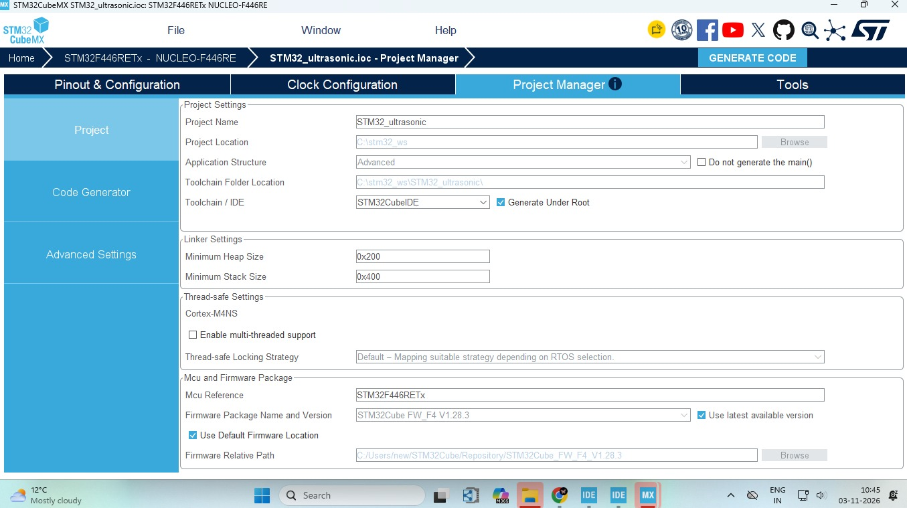
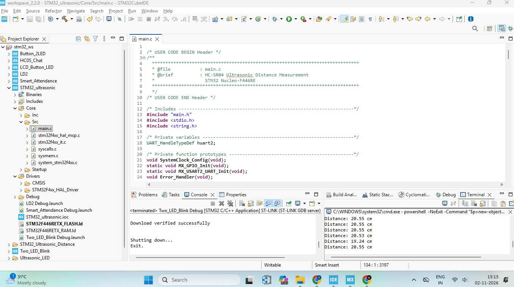
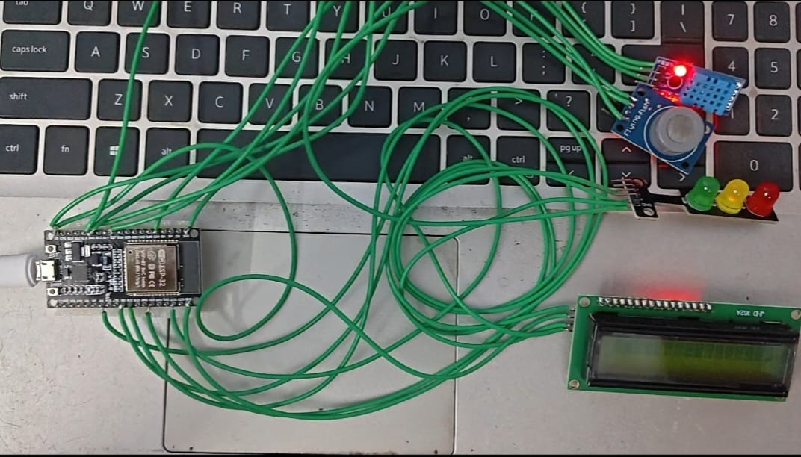

# STM32 NUCLEO-F446RE HC-SR04 Ultrasonic Distance Measurement

## Project Overview

This project demonstrates ultrasonic distance measurement using the **STM32 NUCLEO-F446RE development board** and the **HC-SR04 ultrasonic sensor**.

STM32CubeIDE is used for project development, configuration, code generation, and firmware debugging. Embedded C programming with the STM32 HAL library is used to interface the ultrasonic sensor with the microcontroller.

The HC-SR04 sensor measures the distance to an object by transmitting ultrasonic waves and detecting the reflected signal. The STM32 measures the ECHO pulse duration using the DWT cycle counter and calculates the corresponding distance in centimeters.

The measured distance is transmitted through USART2 at 115200 baud and displayed continuously in the Windows PowerShell terminal.

## Hardware and Software Requirements

- **Development Board:** STM32 NUCLEO-F446RE
- **Microcontroller:** STM32F446RE
- **Ultrasonic Sensor:** HC-SR04
- **Configuration and IDE:** STM32CubeIDE
- **Programming Language:** Embedded C
- **Library:** STM32 HAL
- **Communication Protocol:** UART (USART2)
- **Additional Components:** Breadboard and Jumper Wires
- **Serial Output:** Windows PowerShell

## Pin Configuration

| **HC-SR04 Sensor** | **STM32 NUCLEO-F446RE** |
| ------------------ | ---------------------- |
| VCC                | 5V                     |
| GND                | GND                    |
| TRIG               | PB10                   |
| ECHO               | PC7 (through voltage divider) |

### UART Configuration

| **Parameter** | **Configuration** |
| ------------- | ----------------- |
| Peripheral    | USART2            |
| Baud Rate     | 115200            |
| Word Length   | 8 Bits             |
| Stop Bits     | 1                  |
| Parity        | None               |
| Mode          | Transmit and Receive |

## Project Setup and Implementation

### 1. Pinout and GPIO Configuration

The HC-SR04 ultrasonic sensor is interfaced with the STM32 NUCLEO-F446RE using two GPIO pins.

- **PB10:** Configured as GPIO Output for generating the TRIG pulse.
- **PC7:** Configured as GPIO Input for receiving the ECHO signal.
- **USART2:** Configured for serial communication at 115200 baud.

The GPIO configuration is performed using STM32CubeIDE.

### 2. STM32CubeIDE Project Manager Configuration

The project is configured in STM32CubeIDE by selecting the STM32F446RE microcontroller and configuring the required project settings and development environment.



### 3. STM32CubeIDE Project Window

The generated STM32 project is opened in STM32CubeIDE. The main application logic is implemented in `main.c` using Embedded C and STM32 HAL functions.

The project includes GPIO initialization, USART2 configuration, DWT cycle counter initialization, ultrasonic distance measurement, and UART data transmission.



### 4. Hardware Setup

The HC-SR04 ultrasonic sensor is connected to the STM32 NUCLEO-F446RE development board using a breadboard and jumper wires.

The TRIG and ECHO signals are connected to PB10 and PC7 respectively. The board communicates with the computer through its USB connection.



### 5. PowerShell Serial Output

Windows PowerShell is used to receive and display the distance measurements transmitted by the STM32 board through the USART2 virtual COM port.

The following PowerShell command opens the serial communication port and continuously reads the incoming distance measurements.

**PowerShell Command:**

```powershell
$p = New-Object System.IO.Ports.SerialPort COM26,115200,None,8,one; $p.Open(); while($true){$p.ReadLine()}
```

**Command Explanation:**

- `COM26` – Serial COM port assigned to the STM32 board.
- `115200` – UART communication baud rate.
- `None` – No parity.
- `8` – Eight data bits.
- `one` – One stop bit.
- `$p.Open()` – Opens the serial communication port.
- `$p.ReadLine()` – Continuously reads incoming serial data line by line.

### Output

The distance measurements are continuously displayed in the PowerShell terminal.

```text
Distance: 20.55 cm
Distance: 20.55 cm
Distance: 20.55 cm
Distance: 20.53 cm
Distance: 19.24 cm
Distance: 20.55 cm
```

The displayed values are actual readings captured during project testing.

## Working Principle

1. The STM32 generates a 10-microsecond HIGH pulse on the TRIG pin.
2. The HC-SR04 sensor transmits ultrasonic waves.
3. The ultrasonic waves travel towards the object and get reflected.
4. The ECHO pin generates a pulse based on the ultrasonic wave's round-trip travel time.
5. The STM32 measures the ECHO pulse duration using the DWT cycle counter.
6. The measured time is converted into distance in centimeters.
7. The calculated distance is transmitted through USART2.
8. Windows PowerShell receives and displays the distance measurements.

### Distance Calculation

The distance is calculated using the following formula:

**Distance = (Echo Time × Speed of Sound) / 2**

The division by 2 accounts for the ultrasonic wave travelling to the object and returning to the sensor.

## Key Features

- HC-SR04 ultrasonic sensor interfacing.
- STM32 GPIO configuration using HAL.
- Microsecond delay generation using the DWT cycle counter.
- Accurate ECHO pulse duration measurement.
- Distance calculation in centimeters.
- UART serial communication using USART2.
- Timeout handling when no ECHO signal is detected.
- Continuous distance monitoring with a 500 ms update interval.

## Applications

- Obstacle detection systems
- Robotics and autonomous vehicles
- Object distance measurement
- Industrial automation
- Embedded monitoring systems
- Smart parking systems

## Key Concepts Learned

- STM32 NUCLEO-F446RE development.
- STM32CubeIDE project configuration.
- Embedded C programming.
- STM32 HAL library functions.
- GPIO input and output configuration.
- Ultrasonic sensor interfacing.
- DWT cycle counter and microsecond timing.
- UART serial communication.
- Distance measurement using ultrasonic waves.
- Hardware and firmware integration.

## Conclusion

This project provides practical experience in STM32 embedded firmware development and ultrasonic sensor interfacing.

By integrating the HC-SR04 ultrasonic sensor with the STM32 NUCLEO-F446RE board, the system successfully measures object distances and displays the readings through UART communication using Windows PowerShell.

This project establishes a foundation for developing more advanced embedded systems involving sensors, communication protocols, real-time monitoring, and automation applications.

